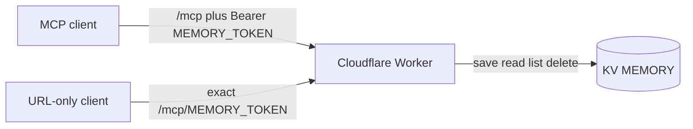
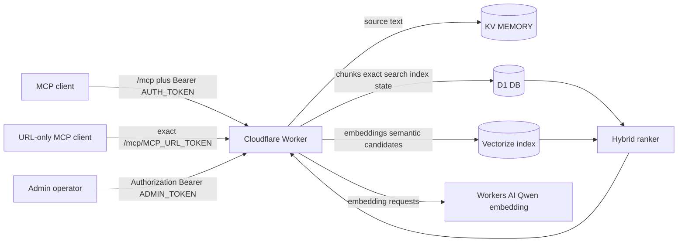
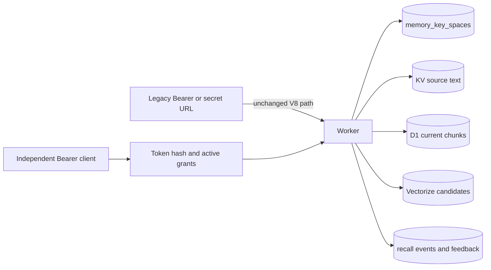

# Architecture

公开版默认入口是 Lite：一个 Worker 通过 MCP 暴露四个受限工具，KV 是唯一存储。它不生成 embedding，也没有 D1、Vectorize 或管理员端点。

需要语义检索时可选择 Vector search，它使用 KV、Workers AI 和 Vectorize。Hybrid V8 再加入 D1，用于精确短语候选、当前 chunk 校验和索引状态恢复。三档都是安全整理后的公开实现，不是历史源码的原样副本。

## Lite

Lite 的 `find_memory_keys` 只搜索 key 名称，必须提供关键词或前缀，且最多返回 20 条。读取正文仍要求完整 key；删除必须提供完全一致的 `confirmKey`。

## Hybrid V8

普通 MCP 的两条入口只改变认证载体，不改变工具权限。新的 V8 一键部署以同一个 `MEMORY_TOKEN` 支持 `/mcp` Bearer 和 `/mcp/<MEMORY_TOKEN>`；旧手工配置仍兼容分别使用 `AUTH_TOKEN` 与 `MCP_URL_TOKEN`。普通 Token 都不能进入 `/admin/*`，管理员接口始终要求独立的 `ADMIN_TOKEN`。错误、未配置或多余层级的秘密 URL 统一视为不存在。

## Write path

`save_memory` 先把通过长度校验的原文写入 KV，再切片、生成 embedding、写入 Vectorize，并在 D1 中替换当前 chunk 与索引状态。索引阶段失败不会回滚已经成功的 KV 写入，而是写入或更新 `pending` 状态。这样原文优先保全，索引可以恢复。

`save_daily` 在同一 owner 与日期下检查冲突。只有显式传入 `overwrite: true` 才能覆盖；如果新索引未成功，旧冲突项会保留，避免重命名过程中丢失可用副本。

## Read path

`get_memory` 只按完整 key 读取 KV。`find_memory_keys` 必须至少有一个过滤条件，并限制返回数量。`get_recent_dailies` 会分页读取 key 后，仅获取受日期上限约束的日记正文。

## Search path

D1 精确短语查询与 Workers AI/Vectorize 语义查询并行运行。Vectorize 候选必须在 D1 当前 chunk 表中仍有对应 ID 才能进入排序。合并后应用精确命中加分、每 key 上限和最终 Top 5 上限。

## Recovery and administration

普通 MCP Token 不能调用 `/admin/*`。管理员 Token 可分页查看 key、查询索引状态，并逐 key 重建。游标分页与逐 key 重建可以由受控脚本组合为分批恢复流程；公开版不内置自动全库遍历或计划任务。

## V9 shadow path（本地开发）

V9 第一阶段不建立第二套正文或向量库，也不修改 V8 的切片和 vector identity。它在现有派生索引上增加 key-to-space 映射、独立 client grant、召回事件与反馈记录：

没有显式映射的旧 key 在授权判断中视为 `legacy-unclassified`。Vectorize metadata 是候选过滤的第一层，D1 与 `memory_key_spaces` 的当前映射是返回前的最终校验，因此陈旧向量 metadata 不会放宽权限，只可能暂时减少语义命中。完整行为和生产前回填计划见 [V9 第一阶段本地实现说明](docs/V9_LOCAL_IMPLEMENTATION.md)。
