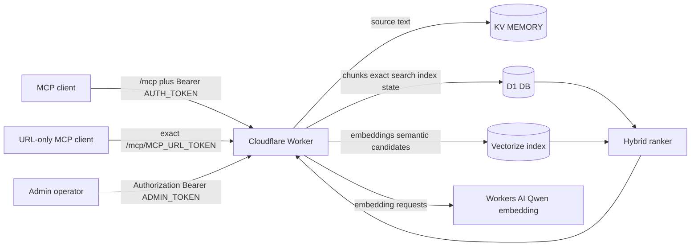

# Architecture

公开版保持 V8 的核心设计：KV 保存原文，D1 与 Vectorize 共同提供可恢复的检索索引，MCP 与管理员端点共享 Worker 入口但使用不同凭据。

仓库同时提供两个较轻的安全部署档：KV-only 省略全部索引服务；Vector search 使用 KV 和 Vectorize，但省略 D1 精确检索及管理员状态表。完整 V8 仍是默认参考实现。

普通 MCP 的两条入口只改变认证载体，不改变工具权限。`/mcp` 只使用 Bearer；可选的 `/mcp/<MCP_URL_TOKEN>` 只在 Secret 合法且路径完全匹配时启用。两者都不能进入 `/admin/*`。错误、未配置或多余层级的秘密 URL 统一视为不存在。

## Write path

`save_memory` 先把通过长度校验的原文写入 KV，再切片、生成 embedding、写入 Vectorize，并在 D1 中替换当前 chunk 与索引状态。索引阶段失败不会回滚已经成功的 KV 写入，而是写入或更新 `pending` 状态。这样原文优先保全，索引可以恢复。

`save_daily` 在同一 owner 与日期下检查冲突。只有显式传入 `overwrite: true` 才能覆盖；如果新索引未成功，旧冲突项会保留，避免重命名过程中丢失可用副本。

## Read path

`get_memory` 只按完整 key 读取 KV。`find_memory_keys` 必须至少有一个过滤条件，并限制返回数量。`get_recent_dailies` 会分页读取 key 后，仅获取受日期上限约束的日记正文。

## Search path

D1 精确短语查询与 Workers AI/Vectorize 语义查询并行运行。Vectorize 候选必须在 D1 当前 chunk 表中仍有对应 ID 才能进入排序。合并后应用精确命中加分、每 key 上限和最终 Top 5 上限。

## Recovery and administration

普通 MCP Token 不能调用 `/admin/*`。管理员 Token 可分页查看 key、查询索引状态，并逐 key 重建。游标分页与逐 key 重建可以由受控脚本组合为分批恢复流程；公开版不内置自动全库遍历或计划任务。
